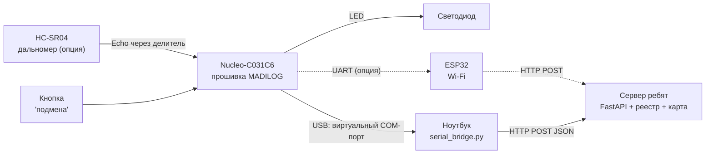

# MADILOG: цены в РФ и схема сборки стенда

Дополняет [BOM_стенд_цены_СНГ.md](BOM_стенд_цены_СНГ.md). Цены смотрел **18.10.2026**. Метки: **[проверено]** — видел цену на странице магазина; **[оценка]** — моя прикидка; **[не нашёл]**.

## 1. Что удалось и не удалось открыть

| Магазин | Результат |
|---|---|
| RoboShop (roboshop.spb.ru) | открылся, цены есть |
| Амперка, Амперкот | открылись частично |
| Chip&Dip, Promelec, Терраэлектроника | страницы не открылись (ошибка или запрет роботам) |
| Ozon | сайт запрещает автоматическое чтение |
| Wildberries | страница не открылась |
| AliExpress.ru | открылась без цен |
| Habr | магазин отказал по частоте запросов, статью я не прочитал |

Поэтому **цен с Ozon, Wildberries, AliExpress и Chip&Dip у меня нет**, и я их не выдумываю. Ссылки на эти магазины ниже даны только для того, чтобы ты сам открыл и сравнил.

## 2. Цены, которые удалось проверить (РФ)

| Деталь | Цена | Магазин | Статус |
|---|---|---|---|
| Плата STM32F103C8T6 (Blue Pill), RoboShop | 480 ₽ | [RoboShop](https://roboshop.spb.ru/arduino/kontrollery-stm/stm32f103c8t6-min-board) | **[проверено]**, 31 шт. в наличии |
| Плата STM32F103C8T6, Амперкот | 280 ₽ | [Амперкот](https://amperkot.ru/products/plata_mikrokontroller_stm32f103c8t6_arm_stm32/24260785.html) | **[проверено]**, есть только в Санкт-Петербурге, в Москве нет |
| Клон CKS32F103C8T6 (аналог) | 200 ₽ | [RoboShop, каталог STM32](https://roboshop.spb.ru/arduino/kontrollery-stm) | **[проверено]**, у клонов бывают проблемы совместимости |
| Black Pill STM32F401 (мощнее) | 650 ₽ | [Амперкот, платы](https://amperkot.ru/products/boards/) | **[проверено]** |
| Программатор ST-Link V2 | 490 ₽ | [RoboShop](https://roboshop.spb.ru/programmator/st-link-v2) | **[проверено]**, но на странице «нет в наличии» |
| Дальномер HC-SR04 | 90–120 ₽ | [RoboShop, ультразвуковые датчики](https://roboshop.spb.ru/sensors/ultrazvukovye-datchiki/) | **[проверено]**, 90 ₽ от 10 шт. |
| Дальномер HC-SR04, Амперка | 900 ₽ | [Амперка](https://amperka.ru/product/hc-sr04-ultrasonic-sensor-distance-module) | **[проверено]**, **в 7 раз дороже**, не бери там |
| Влагозащищённый дальномер JSN-SR04T | 540 ₽ | [RoboShop, ультразвуковые датчики](https://roboshop.spb.ru/sensors/ultrazvukovye-datchiki/) | **[проверено]** |
| Плата ESP32 DevKit V1 | 1 200 ₽ | [Амперка](https://amperka.ru/product/esp32-wroom-wifi-devkit-v1) | **[проверено]** |
| Контроллер ESP32-C3 с OLED | 400 ₽ | [Амперкот, платы](https://amperkot.ru/products/boards/) | **[проверено]**, дешевле DevKit, но годится ли он вам, не проверял |
| Голый модуль ESP-WROOM-32 (без платы под USB, без обвязки) | 460 ₽ | [RoboShop](https://roboshop.spb.ru/modules/moduli-besprovodnoj-svyazi/wi-fi-moduli/esp-32s) | **[проверено]**, нет в наличии, и для стенда не подходит |
| **Nucleo-C031C6** | — | [Chip&Dip](https://chipdip.ru/product1/8018114352) | **[не нашёл]** |
| Резисторы, кнопка, светодиод, провода, макетка | до пары сотен ₽ | любой магазин | **[оценка]** |

Ссылки для самостоятельной проверки (я их не смог прочитать): [Ozon](https://www.ozon.ru/brand/nucleo-87301957/), [Wildberries](https://www.wildberries.ru/catalog/tags/nucleo), [AliExpress](https://aliexpress.ru/popular/hc-sr04-ultrasonic-sensor.html), [Chip&Dip, платы Nucleo](https://www.chipdip.ru/catalog-tags/evaluation-boards-on-microcontroller/nucleo).

## 3. Сколько это стоит: два варианта

### Эконом: Blue Pill + ST-Link
| Позиция | ₽ |
|---|---|
| Плата STM32F103C8T6 | 280–480 |
| ST-Link V2 | 490 |
| Мелочь (кнопка, светодиод, резистор, провода) | **[оценка]** 100–200 |
| **Итого** | **около 900–1 200 ₽** |

Это не включает дальномер и Wi-Fi. Минус: прошивка `main.c` написана под другой чип, её надо перенести. Время на перенос я не оцениваю. Wokwi Blue Pill поддерживает, поэтому проверить можно в симуляторе до покупки.

### Оптимальный: Nucleo-C031C6 (прошивка уже под неё) + дальномер
| Позиция | ₽ |
|---|---|
| Nucleo-C031C6 | **[не нашёл]** |
| HC-SR04 | 90–120 |
| 2 резистора для делителя | **[оценка]** копейки |
| Мелочь | **[оценка]** 100–200 |
| ESP32 по желанию | 1 200 (DevKit) или 400 (C3) |
| **Итого без платы** | **около 300–500 ₽**, плюс Nucleo, плюс ESP32 |

Итоговую сумму назвать не могу, пока нет цены Nucleo. Открой страницу на Chip&Dip, и посчитаем.

## 4. Схема сборки

### 4.1. Как всё связано



Сплошная линия — делаем в любом случае, пунктир — опция.

### 4.2. Подключение деталей

Пины платы указаны так, как они сделаны в уже написанной прошивке (кнопка, светодиод, порт). Для дальномера и ESP32 пины **предложены мной, прошивка для них не написана и не проверена**: сверь с таблицей пинов своей платы (руководство пользователя Nucleo-64 для C031C6 на сайте ST).

```
Nucleo-C031C6                      Подключаемая деталь
─────────────                      ───────────────────
PA2/PA3 (USART2)  ──── уже через ST-LINK ────► USB ► ноутбук (провода не нужны)
PA5   ──[ светодиод ]──[ 1 кОм ]── GND                         (в прошивке)
PC13  ──[ кнопка ]──── GND                                       (в прошивке)
```

Дальномер HC-SR04 (опция, **пины предложены, не проверены**):
```
HC-SR04 VCC  ── 5V  Nucleo
HC-SR04 GND  ── GND Nucleo
HC-SR04 Trig ── PA0 (выход, 3,3 В достаточно)
HC-SR04 Echo ──┬── 1 кОм ──┬── PA1 (вход таймера)
               │           │
               │         2 кОм
               │           │
               └───────── GND         делитель: 5 В → 3,3 В, иначе можно сжечь вход платы
```

ESP32 (опция, **пины предложены, не проверены**):
```
Nucleo PA9  (USART1 TX) ──► ESP32 RX
Nucleo PA10 (USART1 RX) ◄── ESP32 TX
Nucleo GND ────────────── ESP32 GND   (общая земля обязательна)
```
Питание ESP32 берёт по USB отдельно. Обе платы на 3,3 В, преобразователь уровней не нужен.

### 4.3. Порядок сборки
1. Собрать **без деталей**: только Nucleo и USB. Прошить `build/madilog.bin` (плата появится как флешка, файл перетаскивается). Запустить мост и сервер: [ПЛАТА_и_подключение.md](ПЛАТА_и_подключение.md), раздел 5.3. Увидеть «СВОЙ».
2. Добавить кнопку и светодиод (в прошивке они уже есть). Нажать: «ПОДМЕНА ID».
3. Добавить дальномер: сначала проверить его отдельно, и только потом дописывать прошивку.
4. Добавить ESP32 в последнюю очередь, если остаётся время.
Правило: после каждого шага стенд должен работать. Если новый шаг не заработал, откатись на предыдущий и показывай его.

## 5. Видео и материалы

Я нашёл эти ролики по названию, **сам их не смотрел и качество не оцениваю**. Проверь первые минуты, прежде чем тратить время.

HC-SR04 с STM32:
- [Interface HC-SR04 Ultrasonic Sensor with STM32](https://www.youtube.com/watch?v=ti_1ZwRolU4)
- [HC-SR04 Ultrasonic Distance Sensor and STM32](https://www.youtube.com/watch?v=rPKC4xnCfEc)
- На русском, но про общий принцип (не про STM32): [Подключение ультразвукового дальномера HC SR04](https://www.youtube.com/watch?v=Lsewn5V6hp8)

Передача данных на сервер:
- [STM32 UART Tutorial (Part 1)](https://www.youtube.com/watch?v=KdXSRyPCYuM): порт на STM32
- [ESP32 Arduino: HTTP POST Requests](https://www.youtube.com/watch?v=LiQaPJ9UrSM): отправка запроса с ESP32
- [Отправка данных с STM32 на UDP Node.js сервер через ESP8266](https://www.youtube.com/watch?v=6tddHr5ZoOs): близкая схема «плата → ESP → сервер», на русском

Видео по сборке именно MADILOG-подобного «гидроакустического ответчика» я не нашёл. Такие ролики есть по частям (порт, дальномер, Wi-Fi), целиком нет. Чтобы собрать их вместе, как раз нужна эта схема.

## 6. Что дальше
- Пришли цену Nucleo-C031C6 (или скажи, что берёшь Blue Pill), и я пересчитаю итог.
- Если берёшь HC-SR04, я допишу в прошивку измерение дальности и проверю его в Wokwi (в Wokwi есть виртуальный HC-SR04). Предупреждаю: это отдельная работа, а не правка в одну строку.
